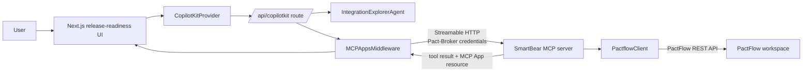
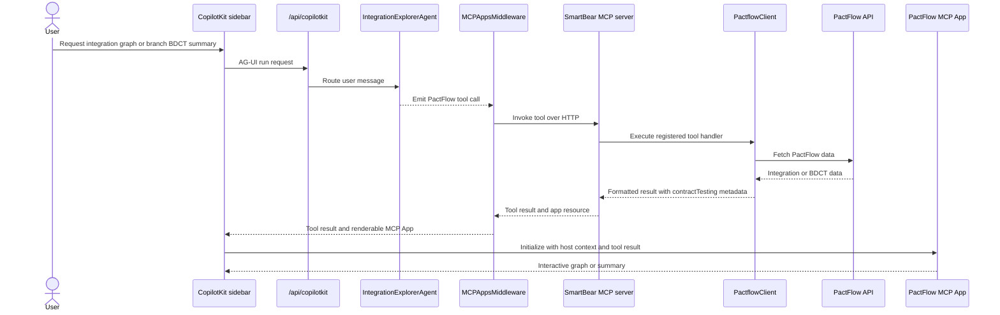

## PactFlow CopilotKit Integration

This Next.js app hosts a CopilotKit chat experience for PactFlow release-readiness workflows. It connects to the SmartBear MCP server over Streamable HTTP and renders the MCP Apps returned by PactFlow tools.

## Architecture



The agent recognizes integration-network and branch-BDCT requests, then emits the matching tool call. `MCPAppsMiddleware` executes that call against the SmartBear MCP server; the agent does not make PactFlow API requests itself.

## Tool and App Lifecycle



PactFlow tools declare an MCP App resource when their result has a dedicated visualization. The server builds a self-contained HTML document from the bundled MCP App client; the app initializes through `postMessage`, receives the tool result, and can render inline or fullscreen.

## Configuration

Set these variables before starting the app:

```bash
SMARTBEAR_MCP_URL=http://localhost:3000/mcp
PACT_BROKER_BASE_URL=https://your-org.pactflow.io
PACT_BROKER_TOKEN=your-pactflow-token
```

`PACT_BROKER_USERNAME` and `PACT_BROKER_PASSWORD` can be supplied instead of `PACT_BROKER_TOKEN`. The route forwards whichever PactFlow credentials are configured to the SmartBear MCP server.

## Run Locally

Start the SmartBear MCP server from the repository root, then start this app:

```bash
npm run dev
```

Open [http://localhost:3001](http://localhost:3001) when the MCP server uses port `3000`, or use the port reported by Next.js.

First, run the development server:

```bash
npm run dev
# or
yarn dev
# or
pnpm dev
# or
bun dev
```

Open [http://localhost:3000](http://localhost:3000) with your browser to see the result.

You can start editing the page by modifying `app/page.tsx`. The page auto-updates as you edit the file.

## Learn More

To learn more about Next.js, take a look at the following resources:

- [Next.js Documentation](https://nextjs.org/docs) - learn about Next.js features and API.
- [Learn Next.js](https://nextjs.org/learn) - an interactive Next.js tutorial.

You can check out [the Next.js GitHub repository](https://github.com/vercel/next.js) - your feedback and contributions are welcome!

## Deploy on Vercel

The easiest way to deploy your Next.js app is to use the [Vercel Platform](https://vercel.com/new?utm_medium=default-template&filter=next.js&utm_source=create-next-app&utm_campaign=create-next-app-readme) from the creators of Next.js.

Check out our [Next.js deployment documentation](https://nextjs.org/docs/app/building-your-application/deploying) for more details.
