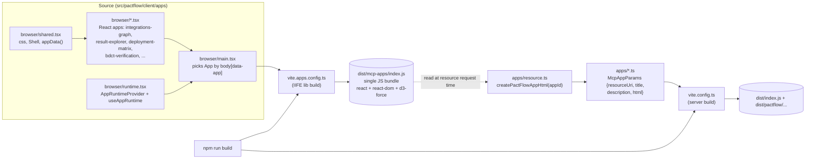
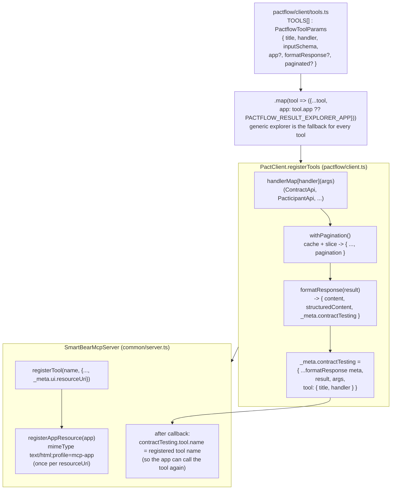
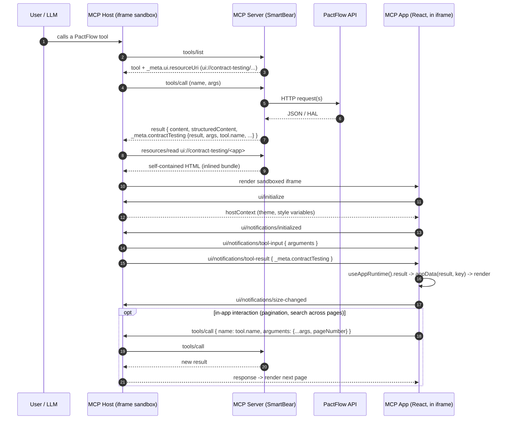
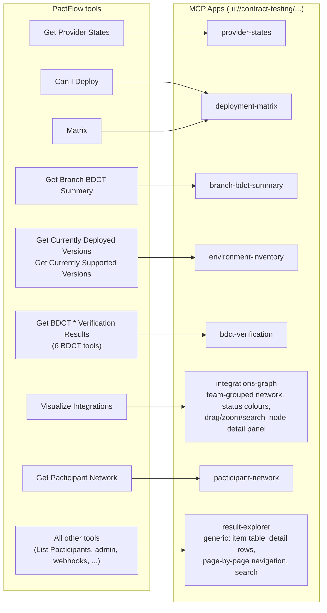
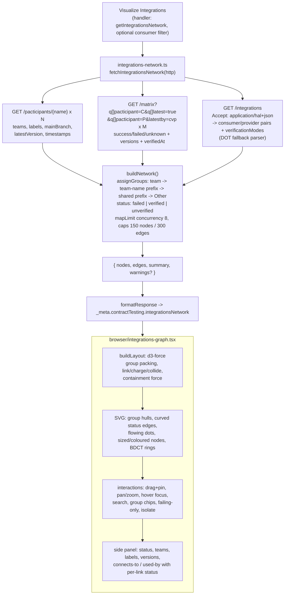
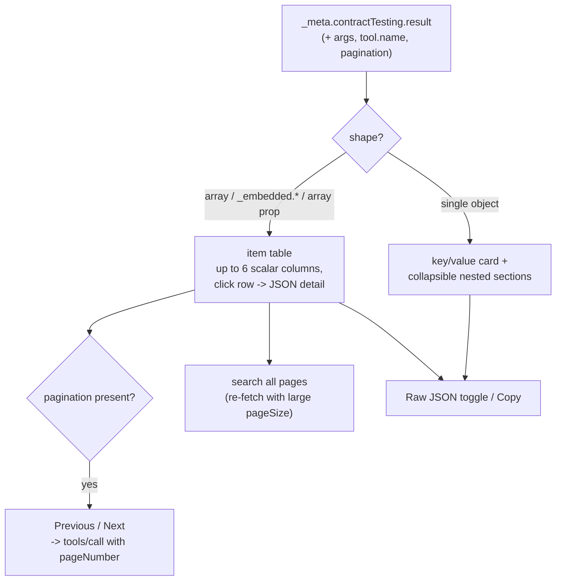

# PactFlow MCP Apps integration

How PactFlow tools render interactive UIs inside MCP hosts (SEP-1865 "MCP Apps").

## 1. Build pipeline

`html` is either a lazy function (`createPactFlowAppHtml("<id>")`, which inlines the bundle into a self-contained
`<!doctype html>` document with `<body data-app="<id>">`) or, for `result-explorer.ts`, a self-contained HTML string.

## 2. Server-side registration

## 3. Runtime: tool call to rendered UI

## 4. Tool to app mapping

## 5. `integrations-graph` data flow

## 6. `result-explorer` (generic fallback) behaviour

## 7. Key files

| Concern | File |
| --- | --- |
| Tool definitions, app assignment, `formatAppResponse` | `src/pactflow/client/tools.ts` |
| Tool registration, pagination wrapper, `_meta.contractTesting` | `src/pactflow/client.ts`, `src/pactflow/client/pagination.ts` |
| App resource registration, tool name injection | `src/common/server.ts` (`registerAppResource`) |
| App definitions (`McpAppParams`) | `src/pactflow/client/apps/*.ts`, `src/common/types.ts` |
| Bundle embedding | `src/pactflow/client/apps/resource.ts` |
| React apps and host runtime (JSON-RPC over `postMessage`) | `src/pactflow/client/apps/browser/*.tsx` |
| Network data builder | `src/pactflow/client/integrations-network.ts` |
| Bundle build config | `vite.apps.config.ts`, `package.json` (`build`) |
